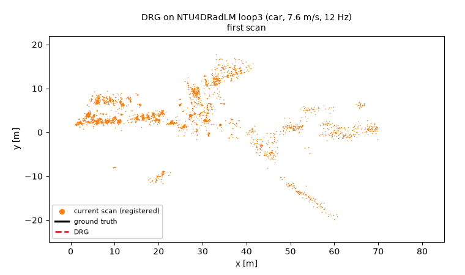
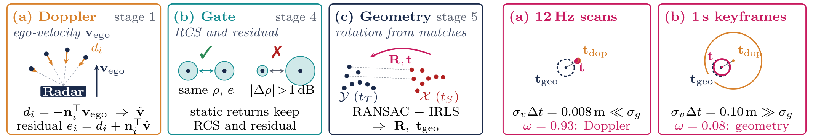

<div align="center">
    <h1>DRG</h1>
    <h3>4D Radar Scan-to-Scan Registration using Doppler Translation Fusion</h3>
    <a href="#installation"></a>
    <a href="#run-on-a-rosbag-ros-noetic"></a>
    <a href="#installation"></a>
    <a href="#citation"></a>
    <a href="LICENSE"></a>
  <br />
  <br />
  <p><strong><em>Training-free registration of consecutive 4D radar scans with Doppler velocity and radar cross section (RCS)</em></strong></p>
</div>

---

## 📄 Resources

- **Paper**: *4D Radar Scan-to-Scan Registration using Doppler Translation Fusion*, Van Minh Duc Nguyen,
  Tiancheng Li, Zhenzi Li, Alen Alempijevic, Shoudong Huang, Australasian Conference on Robotics and
  Automation (ACRA), 2026.
- **Tutorial**: 📂 [`example/example.ipynb`](example/example.ipynb), the six stages on real radar data. It needs no ROS and no dataset download.
- **Released estimates**: 📂 [`results/`](results), DRG's estimate for each of the 51,940 scan pairs behind the paper's tables, and the trajectories of all six sequences with ground truth, ready for evo.

<p align="center">
  
</p>

**DRG** (Doppler–RCS Gated registration) estimates the rigid transform between two consecutive scans
of a 4D imaging radar. It needs no training. It uses the two radar-native cues that geometric
pipelines ignore: the **Doppler velocity** and the **radar cross section (RCS)** of every return.

## 🍎 How DRG works

<p align="center"></p>

| Stage | What it does | Code |
|---|---|---|
| 1 Soft-REVE | Ego-velocity **v̂** from Doppler (3-point RANSAC + least squares). Every return gets a Doppler residual *e*ᵢ and a soft confidence *w*ᵢ | [`ego_velocity.py`](src/drg/ego_velocity.py) |
| 2 37-D descriptor | 33-D FPFH + 4 radar channels [RCS, *w*ᵢ, neighbour count, height] | [`descriptor.py`](src/drg/descriptor.py) |
| 3 Matching | Mutual nearest neighbours in the 37-D space | [`correspondence.py`](src/drg/correspondence.py) |
| 4 Doppler–RCS gate | Keep a match only if \|Δρ\| ≤ 1 dB and \|Δe\| ≤ 0.01 m/s | [`correspondence.py`](src/drg/correspondence.py) |
| 5 Geometry | Correspondence RANSAC + truncated-Cauchy IRLS → **R**, **t**_geo | [`solver.py`](src/drg/solver.py) |
| 6 Doppler fusion | **t** = ω **t**_dop + (1−ω) **t**_geo. The weight ω depends on Δt alone: 0.93 at 12 Hz, 0.08 at 1 s | [`fusion.py`](src/drg/fusion.py) |

<p align="center"></p>

## 📊 Results

Every consecutive scan pair of six [NTU4DRadLM](https://github.com/junzhang2016/NTU4DRadLM)
sequences (Oculii Eagle, 12 Hz; garden at its ~1 s keyframes), 51,940 pairs in total. TE [m] and RE [°]
are the translation and rotation errors of each pair against the ground truth.

| DRG | cp | garden | nyl | loop1 | loop2 | loop3 |
|---|---|---|---|---|---|---|
| platform | handcart | handcart | handcart | car | car | car |
| pairs | 5,256 | 272 | 11,243 | 15,992 | 11,568 | 7,609 |
| mean TE [m] | 0.0135 | 0.0554 | 0.0229 | 0.0736 | 0.0687 | 0.0778 |
| mean RE [°] | 0.189 | 0.555 | 0.223 | 0.101 | 0.142 | 0.114 |
| median TE [m] | 0.0104 | 0.0459 | 0.0164 | 0.0487 | 0.0447 | 0.0532 |
| *t*_rel [%] (chained, no back end) | 1.55 | 6.56 | 5.83 | 9.03 | 7.30 | 5.94 |
| *r*_rel [°/m] | 0.0465 | 0.0761 | 0.0225 | 0.0298 | 0.0242 | 0.0240 |

The paper compares DRG with FPFH + TEASER++, APDGICP (the 4DRadarSLAM front end) and the retrained
learned methods RaFlow and CAO-RONet. Leaving aside the learned methods' within-sequence test splits,
DRG has the lowest mean TE on five of the six sequences and the lowest median TE on all six. The
exception is garden, whose keyframes are ~1 s apart, so the fusion weight is only 0.08. Trained on
the first part of a loop and tested on its last 20 %, CAO-RONet beats DRG in translation on the
three loops. In rotation, DRG matches the best geometric method once the few gap-spanning pairs
(sensor dropouts) are set aside.

**Most of the translation gain comes from the Doppler fusion (stage 6), not from a better
registration.** At 12 Hz the fused translation is 93 % Doppler, and the same fusion applied to
APDGICP gives the same accuracy.

<p align="center"></p>
<p align="center"><em>Chained per-pair estimates (no keyframes, smoothing or loop closure) on the four longest sequences (paper, Fig. 4).</em></p>

All numbers above can be recomputed from the released estimates in seconds; see
[Reproducing the paper](#reproducing-the-paper).

## 🍎 Tutorial (Python)

Open 📂 [`example/example.ipynb`](example/example.ipynb) for a step-by-step walk-through.
[`example/data`](example/data) (3 MB) holds 31 consecutive scans of NTU4DRadLM *loop3*, a car at
7.6 m/s. They are exactly the clouds the paper registered for its windowed set *loop3 set 4*. The
notebook covers:

- **A 4D radar scan**: x, y, z, RCS and Doppler of every return
- **Stage 1, Soft-REVE**: ego-velocity from Doppler, residuals and confidence weights
- **Stage 2**: the 37-D descriptor
- **Stages 3–4**: mutual nearest neighbours and the Doppler–RCS gate, with how often RCS repeats between frames
- **Stages 5–6**: geometric and Doppler translations, the fusion, and the error against the ground truth
- **The whole window**: 30 pairs, checked against the paper's estimates (they agree to ~1e-10 m)

```bash
pip3 install -r requirements.txt notebook
cd example && jupyter notebook example.ipynb
```

The same check from the command line (about 1 min):

```bash
python3 scripts/reproduce_windowed_sets.py --datasets example/datasets.yaml --sets loop3_set4_5692
# 30 pairs compared with the paper: ... max |dT| = 3.10e-11   loop3  30  0.0440  0.133   PASSED
```

## Installation

**Dependencies.** Python ≥ 3.8 with NumPy, SciPy, PyYAML and **Open3D 0.18.0** (the version used for
the paper). ROS Noetic is needed for the node, and [evo](https://github.com/MichaelGrupp/evo) for the
trajectory metrics. Tested on Ubuntu 20.04 with ROS Noetic (Python 3.8) and, without ROS, with
Python 3.11.

```bash
# 1. clone into a catkin workspace
mkdir -p ~/catkin_ws/src && cd ~/catkin_ws/src
git clone https://github.com/minhduc251101/DRG.git

# 2. Python dependencies
pip3 install -r DRG/requirements.txt

# 3. build (the ROS package is called drg)
cd ~/catkin_ws && catkin_make        # or: catkin build drg
source devel/setup.bash
```

Without ROS, step 2 is enough: the library, the scripts and the notebook run from the repository
folder (or `pip3 install -e .` installs the `drg` package).

**Python API.**

```python
from drg import DRG, DRGParams, NormStats

drg = DRG(DRGParams(), NormStats.from_yaml("config/norm_stats/loop3.yaml"))

# a scan is an (N, 5) array: x, y, z [m], RCS [dB], Doppler [m/s] (raw range rate, not ego-compensated)
target = drg.prepare(scan_k)                               # stages 1-2, once per scan
source = drg.prepare(scan_k1)
result = drg.register(source, target, dt=t_k1 - t_k)       # stages 3-6

result.T              # 4x4, maps source points into the target frame
result.fusion_weight  # the weight of Eq. 8 (0.93 at 12 Hz)
result.n_gated        # correspondences kept by the Doppler-RCS gate
```

## Run on a rosbag (ROS Noetic)

**Data.** Download a sequence of [NTU4DRadLM](https://github.com/junzhang2016/NTU4DRadLM), e.g.
`loop3`: `loop3_2022-06-03_{0,1,2}.bag` and `gt_odom.txt`. DRG reads the radar topic
`/radar_enhanced_pcl` (`sensor_msgs/PointCloud`, channels `Doppler` and `Power` = RCS).

**One command** starts the node and RViz and plays the bags:

```bash
roslaunch drg ntu4dradlm.launch sequence:=loop3 output_dir:=$HOME/drg_out/loop3 \
    bags:="$(ls /data/NTU4DRadLM/loop3/*.bag | xargs)"
```

| Argument | Default | Meaning |
|---|---|---|
| `sequence` | `cp` | selects `config/norm_stats/<sequence>.yaml`: `cp`, `garden`, `nyl`, `loop1`, `loop2`, `loop3` |
| `bags` | – | bag files separated by spaces, played in this order |
| `rate` | `0.05` | playback rate (see *Speed* below) |
| `ransac_trials` | `40` | paper value. `1` gives the same estimates about 13× faster |
| `output_dir` | – | where `stamp_est_traj.txt` and `relative_poses.txt` are written |
| `rviz` | `true` | show the trajectory and the registered scans (coloured by RCS) |
| `play_args` | – | extra `rosbag play` options, e.g. `play_args:="-s 60 -u 20"` for a 20 s test from 60 s |

**Or step by step**, with your own `rosbag play`:

```bash
roscore
roslaunch drg drg.launch norm_stats:=$(rospack find drg)/config/norm_stats/loop3.yaml \
    output_dir:=$HOME/drg_out/loop3
rosbag play --clock -r 0.05 /data/NTU4DRadLM/loop3/loop3_2022-06-03_{0,1,2}.bag --topics /radar_enhanced_pcl
```

**Speed.** `rosbag play` first indexes the bags, about 1 min per 3 GB bag file, before the first
scan arrives. DRG is a single-threaded Python implementation and takes about 1–5 s per scan pair with
the paper's 40 RANSAC trials (0.4 s with `ransac_trials:=1`), against an 83 ms frame period. The node
**never drops a scan**, because it registers consecutive scans; it only falls behind. Play the bags
slowly or let the node work through its queue. It logs `[DRG] scan N` for every scan and flushes
the output files after every pair.

**Topics and frames.**

| Topic | Type | |
|---|---|---|
| `/radar_enhanced_pcl` (input, remap with `input_topic:=`) | `sensor_msgs/PointCloud` | `cloud_type:=PointCloud2` for PointCloud2 input |
| `/drg_odometry/odometry` | `nav_msgs/Odometry` | radar pose in `odom` |
| `/drg_odometry/path` | `nav_msgs/Path` | |
| `/drg_odometry/cloud_registered` | `sensor_msgs/PointCloud2` | current scan in `odom`, intensity = RCS |
| TF `odom → radar_body` | | |

The raw radar points are rotated into the body axes of 4DRadarSLAM (`rotate_to_body:=true`, a 3.13°
rotation; the translation is dropped). The axes are then parallel to the Livox / ground-truth frame
and the origin stays at the radar, as in the paper. Set `rotate_to_body:=false` for other radars and
for clouds that are already rotated.

**The paper's exact input.** The paper did not register the raw scans. It registered the output of
the preprocessing of [4DRadarSLAM](https://github.com/zhuge2333/4DRadarSLAM) (its
[Go-RIO](https://github.com/wooseongY/Go-RIO) version), topic `/filtered_points`: the raw points
rotated into the body axes, range and radius-outlier filtered, without the scans in which the
platform stands still. The paper's per-scan dumps store exactly these clouds (checked field by field
on nyl). With 4DRadarSLAM running on the same bag, DRG registers the same input as in the paper:

```bash
roslaunch drg drg.launch input_topic:=/filtered_points cloud_type:=PointCloud2 rotate_to_body:=false \
    norm_stats:=$(rospack find drg)/config/norm_stats/loop3.yaml output_dir:=$HOME/drg_out/loop3_paper
```

Registering the raw scans instead changes little: on the same 7,609 loop3 pairs the mean TE goes
from 0.0778 m (paper input) to 0.0776 m, and the mean RE changes in the fourth decimal (measured
offline, with normalisation statistics from the raw scans). The other sequences were not measured
this way.

## Evaluate against ground truth

The node and `scripts/register_dump.py` write two files:

* `stamp_est_traj.txt`: the chained trajectory P<sub>k+1</sub> = P<sub>k</sub> T<sub>k</sub> in TUM format
* `relative_poses.txt`: one line per pair: `stamp_target stamp_source` + the top 3×4 of **T**

**The paper's metrics** (Tables 1 and 3):

```bash
# per-pair TE / RE (use --max-gt-gap 0.15 on nyl)
python3 scripts/evaluate_pairs.py --est ~/drg_out/loop3/relative_poses.txt --gt /data/NTU4DRadLM/loop3/gt_odom.txt

# KITTI relative drift t_rel / r_rel over 100-800 m segments
python3 scripts/evaluate_trajectory.py --est ~/drg_out/loop3/relative_poses.txt --gt /data/NTU4DRadLM/loop3/gt_odom.txt
```

**With [evo](https://github.com/MichaelGrupp/evo).** The ground truth is sampled at 10 Hz and the
radar at 12 Hz. evo's nearest-stamp matching (`--t_max_diff`) can be up to 50 ms off, which is up to
0.4 m at car speed. Interpolate the ground truth at the radar stamps first, as the paper does:

```bash
cd ~/drg_out/loop3
python3 ~/catkin_ws/src/DRG/scripts/interpolate_gt.py --gt /data/NTU4DRadLM/loop3/gt_odom.txt \
    --est stamp_est_traj.txt --out stamp_gt_traj.txt

# absolute trajectory error after SE(3) alignment
evo_ape tum stamp_gt_traj.txt stamp_est_traj.txt -va --plot --save_results ape.zip
# relative pose error between consecutive scans (close to the paper's per-pair TE)
evo_rpe tum stamp_gt_traj.txt stamp_est_traj.txt -va --delta 1 --delta_unit f --pose_relation trans_part
```

On the tutorial window, interpolation lowers the APE RMSE from 0.23 m (nearest stamp) to 0.050 m.
`evo_rpe` gives a mean of 0.0442 m against the paper's 0.0440 m; the two differ only in how the error
transform is composed.

**The paper's trajectories.** [`results/trajectories/<sequence>/`](results/README.md#trajectories-for-evo)
holds DRG's trajectory and the ground truth at the same stamps for all six sequences of the paper,
so evo runs on them directly:

```bash
evo_ape tum results/trajectories/loop3/stamp_gt_traj.txt results/trajectories/loop3/stamp_est_traj.txt -va --plot
```

## Reproducing the paper

There are three levels, from fastest to most complete.

**(a) Re-score the released estimates (seconds).** `results/relative_poses/<seq>.txt` holds DRG's
estimate for every pair of Table 1, exactly as produced for the paper. Scoring them gives the DRG
rows of Tables 1 and 3, the numbers in [Results](#-results):

```bash
python3 scripts/evaluate_pairs.py      --est results/relative_poses/loop3.txt --gt /data/NTU4DRadLM/loop3/gt_odom.txt
python3 scripts/evaluate_trajectory.py --est results/relative_poses/loop3.txt --gt /data/NTU4DRadLM/loop3/gt_odom.txt
# nyl: add --max-gt-gap 0.15
```

`results/trajectories/` holds the same estimates chained into trajectories for evo, with the
ground truth at the same stamps; `scripts/export_trajectories.py` rebuilds them
([results/README.md](results/README.md#trajectories-for-evo)).

**(b) Re-run DRG on the paper's input.** The paper registers the per-scan clouds that 4DRadarSLAM
(Go-RIO version) writes with its `/radar_graph_slam/dump` service (one folder per scan, with
`cloud.pcd` and the stamp). Setting the keyframe thresholds to zero
(`keyframe_delta_trans_back_end:=0 keyframe_delta_angle:=0`) keeps every scan; garden uses the
default ~1 s keyframes. With such dumps:

```bash
# one window, e.g. carpark tuning set 1 (30 pairs from frame 4470)
python3 scripts/register_dump.py --dump /data/dumps/cp --stats config/norm_stats/cp.yaml \
    --gt /data/NTU4DRadLM/cp/gt_odom.txt --start 4470 --num-pairs 30 --out results/cp_set1

# all 37 windowed sets, compared pair by pair with the paper's estimates
cp config/datasets_example.yaml config/datasets.yaml     # edit the paths
python3 scripts/reproduce_windowed_sets.py --datasets config/datasets.yaml
```

**(c) From the rosbag.** See [Run on a rosbag](#run-on-a-rosbag-ros-noetic). On the raw
`/radar_enhanced_pcl` scans the results differ slightly from the paper's (see above). On 4DRadarSLAM's
`/filtered_points` the node registers the paper's input.

### Verification

* **Released estimates.** Re-scored with `evaluate_pairs.py` and `evaluate_trajectory.py`, they give the
  paper's mean / median TE and RE (Table 1) and *t*_rel / *r*_rel (Table 3) on all six sequences.
* **Library.** `reproduce_windowed_sets.py` reruns all 37 windowed sets (1,110 pairs) with Open3D 0.18.0.
  690 pairs are bit-identical to the paper's estimates and all agree within 2.5e-10 m, which is
  floating-point rounding (`tests/reference/windowed_sets_seed42.json`).
* **ROS node.** In ROS Noetic (Python 3.8), the node fed the tutorial window as 4DRadarSLAM-style
  `/filtered_points` messages reproduces the paper's 30 estimates to 3e-11 m. On a slice of the raw
  loop3 bag, played through `ntu4dradlm.launch`, it matches the library on the same scans to 2e-12 m.
* **Unit tests.** `python3 -m pytest tests/` runs on synthetic scans and on the tutorial window.

## Parameters and how they were tuned

All parameters are in [`config/drg.yaml`](config/drg.yaml). **[docs/PARAMETERS.md](docs/PARAMETERS.md)**
explains each one: what it does, which values were tried, the results on the tuning sets, and how to
adapt DRG to another radar. In short:

| Parameter | Value | Purpose | How it was set |
|---|---|---|---|
| `tau_rcs` | 1 dB | gate: max RCS difference of a match | radar property: RCS repeats bit-exactly for 85–88 % of true matches. Tuned: 0.5 dB gave the same result |
| `tau_residual` | 0.01 m/s | gate: max Doppler-residual difference | 3–10 × the median of true matches. Tuned: 0.005 m/s gave the same result |
| `inlier_distance` | 0.3 m | RANSAC inlier distance = IRLS truncation | 3 × the 0.1 m FPFH voxel. Tuned: 0.2 m gave the same result |
| `cauchy_c` | 0.1 m | Cauchy scale of the IRLS | tuned: 0.05 m changed TE by ≤ 0.1 mm |
| `sigma_v` | 0.10 m/s | ego-velocity accuracy (fusion) | not tuned: literature (RAVE: 0.04–0.14 m/s) |
| `sigma_g` | 0.03 m | geometric translation accuracy (fusion) | not tuned: per-pair geometric error on the tuning sets |
| `radar_block_weight` | 0.5 | weight of the radar channels in the descriptor | not tuned: equal weighting |
| `ransac_trials` | 40 | RANSAC restarts | not tuned. 1 trial gives the same estimates, ~13× faster |

**Protocol.** All development decisions were made on five windowed sets of 30 pairs: carpark sets
1–3 (12 Hz) and garden sets 1–2 (1 s keyframes). The design choices (descriptor, matching, robust
loss, gate, refinement, fusion) were compared on carpark set 1 and garden set 1. Two of them
mattered: explicit mutual-NN correspondences with correspondence RANSAC (instead of feature-matching
RANSAC) and the Doppler fusion. The four tuned constants were varied on the two garden sets, where
geometry carries the translation. **DRG is insensitive to all of them**: no variant changed the mean
TE by more than 0.3 mm, so the starting values were kept and frozen. The other 32 windowed sets and all 51,940 pairs, including the car
sequences at 5–7 m/s, were then run once with these values. The fusion weight is not tuned: it
follows from Δt alone, ω = 1 / (1 + (σ<sub>v</sub> Δt / σ<sub>g</sub>)²).

## Repository layout

```
DRG/
├── src/drg/                     # the algorithm (pure Python; no ROS needed)
│   ├── params.py                #   every constant, with its meaning
│   ├── ego_velocity.py          #   stage 1    Soft-REVE
│   ├── descriptor.py            #   stage 2    37-D descriptor + normalisation statistics
│   ├── correspondence.py        #   stages 3-4 mutual NN + Doppler-RCS gate
│   ├── solver.py                #   stage 5    RANSAC + Cauchy IRLS
│   ├── fusion.py                #   stage 6    Doppler translation fusion
│   ├── registration.py          #   DRG class: prepare(scan) + register(source, target, dt)
│   ├── radar_frames.py          #   NTU4DRadLM radar -> body rotation
│   ├── ros_conversions.py       #   PointCloud / PointCloud2 -> numpy
│   ├── io.py, sequence.py       #   4DRadarSLAM dump reader, pair loop
│   └── evaluation.py            #   GT interpolation, TE / RE, KITTI drift, TUM output
├── nodes/drg_odometry_node.py   # ROS1 node
├── launch/                      # drg.launch (node), ntu4dradlm.launch (node + rosbag play)
├── config/
│   ├── drg.yaml                 # the paper's parameters
│   └── norm_stats/<seq>.yaml    # descriptor normalisation statistics per sequence
├── example/                     # tutorial notebook + 31 scans of loop3 + ground truth
├── scripts/                     # offline registration, evaluation and reproduction
├── results/
│   ├── relative_poses/          # DRG's per-pair estimates behind the paper's tables
│   └── trajectories/            # the same, chained into trajectories + ground truth (TUM, for evo)
├── tests/                       # unit tests + the paper's estimates of the 37 windowed sets
└── docs/PARAMETERS.md           # what every parameter does and how it was chosen
```

## Notes and limitations

* **Runs offline.** About 1–5 s per pair with 40 RANSAC trials and 0.4 s with one trial, on one CPU core.
  Real time at 12 Hz needs a compiled implementation.
* **Normalisation statistics** of the descriptor are computed per sequence from every 10th scan
  (`scripts/compute_norm_stats.py`), as in the paper. They include future scans, so the evaluated
  pipeline is not causal. Using another sequence's statistics changed the mean TE by at most 0.14 mm.
* **Doppler convention.** DRG expects the raw signed range rate (negative = approaching) and fits
  d = −n·v. The Doppler prior only helps at frame rate: at 1 s keyframes DRG reduces to its geometric
  back end.
* **Radar timestamps.** The stamp intervals of this radar alternate long and short. The ground truth is
  interpolated at these stamps and **t**_dop uses the same Δt, which can favour DRG in per-pair TE
  (paper, Sec. 4.1).
* **One radar.** The evidence covers one sensor (Oculii Eagle). The 1 dB RCS threshold depends on its
  RCS repeatability; re-tune it for another radar ([docs/PARAMETERS.md](docs/PARAMETERS.md#adapting-drg-to-another-radar)).
* The only failure check is a plausibility test (|**t**| ≤ 5 m, roll and pitch ≤ 10°). If every
  hypothesis fails, DRG returns the identity and the node logs `FAILED`.

## Dataset

The experiments use the [**NTU4DRadLM**](https://github.com/junzhang2016/NTU4DRadLM) 4D radar dataset.
Many thanks to Jun Zhang *et al.* for releasing it. The tutorial data in `example/data` are a short
excerpt of its *loop3* sequence, after 4DRadarSLAM preprocessing.

## Citation

```bibtex
@inproceedings{nguyen2026drg,
  title     = {{4D} Radar Scan-to-Scan Registration using Doppler Translation Fusion},
  author    = {Nguyen, Van Minh Duc and Li, Tiancheng and Li, Zhenzi and Alempijevic, Alen and Huang, Shoudong},
  booktitle = {Proceedings of the Australasian Conference on Robotics and Automation (ACRA)},
  year      = {2026}
}
```

## Acknowledgements

We thank the authors of [NTU4DRadLM](https://github.com/junzhang2016/NTU4DRadLM),
[4DRadarSLAM](https://github.com/zhuge2333/4DRadarSLAM), [REVE](https://github.com/christopherdoer/reve),
[Open3D](http://www.open3d.org) and [evo](https://github.com/MichaelGrupp/evo).

## License

[MIT](LICENSE)
