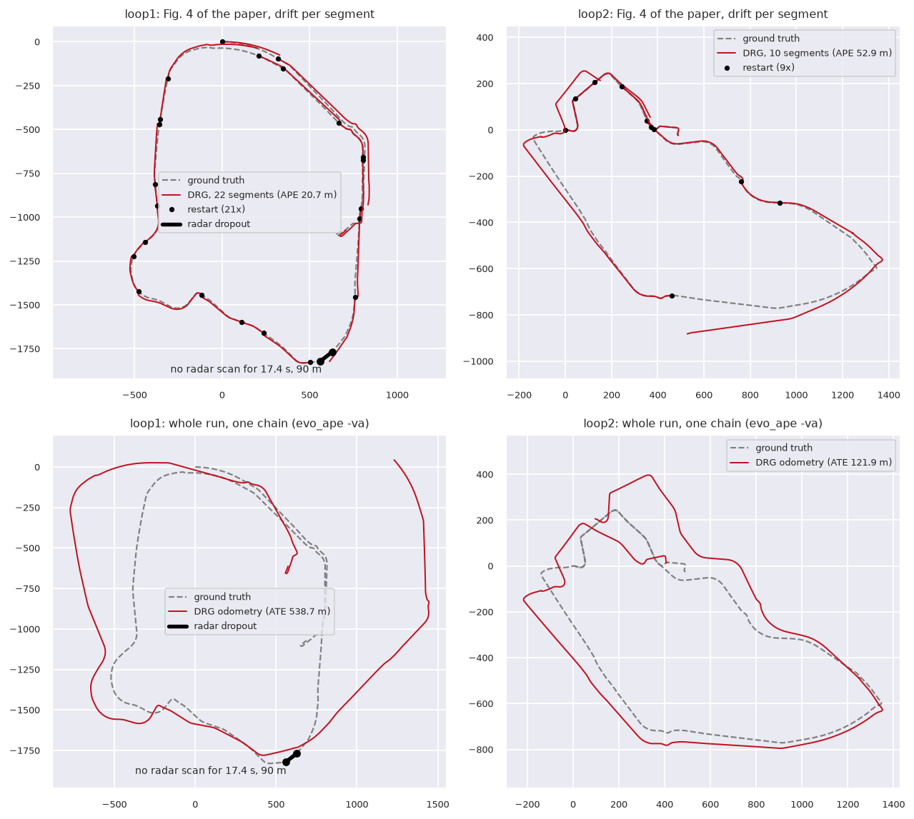

# Released results

Everything here was produced on 24 Nov 2026 by **rerunning this repository's code** (commit 7349f7a,
`scripts/register_dump.py`, the paper's parameters) on every consecutive scan pair of the NTU4DRadLM
sequences, then scoring the output against the ground truth with
[evo](https://github.com/MichaelGrupp/evo) (`evo_ape -va`). No number is copied from the paper.

* [`relative_poses/`](#per-pair-estimates): DRG's estimate for every consecutive scan pair; the
  paper's Tables 1 and 3 are recomputed from them
* [`trajectories/`](#odometry-trajectories): the same estimates chained over the whole run, i.e. the
  trajectory DRG outputs, with the ground truth, `evo_ape -va` results and plots
* [`slam_backend/`](slam_backend/README.md): **not in the paper.** DRG as the front end of the full
  4DRadarSLAM system, run with loop closure off and on, with `evo_ape -va` results
* [`snail_radar/`](snail_radar/README.md): **not in the paper.** The same code on five SNAIL-Radar sequences
  (Oculii Eagle and Continental ARS548): odometry, and 4DRadarSLAM on the ARS548, with `evo_ape -va` results

## Per-pair estimates

`relative_poses/<sequence>.txt` holds DRG's estimate for **every consecutive pair** of the run,
including the few pairs whose frames have no ground truth. One line per pair:

```
stamp_target stamp_source  r11 r12 r13 tx  r21 r22 r23 ty  r31 r32 r33 tz
```

**T** maps points of the source scan (the later one) into the frame of the target scan. The
frame is the radar-centred body frame (radar origin, Livox axes).

As in the paper, a pair is scored only if both of its frames have a ground-truth sample within
0.1 s (nyl: 0.15 s); `scripts/evaluate_pairs.py` and `scripts/evaluate_trajectory.py` skip the others
(and cut the chain there for *t*_rel). On the pairs the paper scored, the rerun gives the paper's own
estimates (released with commit 7349f7a) to within the last column, and the scores below are
Tables 1 and 3 of the paper:

| sequence | pairs | scored | mean TE [m] | median TE [m] | mean RE [°] | median RE [°] | *t*_rel [%] | *r*_rel [°/m] | max \|ΔT\| to the paper's estimates | `--max-gt-gap` |
|---|---|---|---|---|---|---|---|---|---|---|
| cp | 5,256 | 5,256 | 0.0135 | 0.0104 | 0.189 | 0.156 | 1.55 | 0.0465 | 5e-11 | 0.1 |
| garden (keyframes) | 272 | 272 | 0.0554 | 0.0459 | 0.555 | 0.473 | 6.56 | 0.0761 | 1e-9 | 0.1 |
| nyl | 11,243 | 11,243 | 0.0229 | 0.0164 | 0.223 | 0.188 | 5.83 | 0.0225 | 2e-8 | 0.15 |
| loop1 | 16,038 | 15,992 | 0.0736 | 0.0487 | 0.101 | 0.062 | 9.03 | 0.0298 | 3e-8 | 0.1 |
| loop2 | 11,587 | 11,568 | 0.0687 | 0.0447 | 0.142 | 0.084 | 7.30 | 0.0242 | 2e-7 | 0.1 |
| loop3 | 7,619 | 7,609 | 0.0778 | 0.0532 | 0.114 | 0.084 | 5.94 | 0.0240 | 6e-9 | 0.1 |

Recompute any row with the dataset's `gt_odom.txt`:

```bash
python3 scripts/evaluate_pairs.py      --est results/relative_poses/loop2.txt --gt <NTU4DRadLM>/loop2/gt_odom.txt
python3 scripts/evaluate_trajectory.py --est results/relative_poses/loop2.txt --gt <NTU4DRadLM>/loop2/gt_odom.txt
```

`garden_every_scan.txt` (not in the paper) registers every scan of the garden run instead of the
paper's 1 s keyframes. It is the odometry of the garden SLAM run.

## Odometry trajectories

`trajectories/<sequence>/` holds:

| file | content |
|---|---|
| `stamp_est_traj.txt` | DRG odometry: the estimates of `relative_poses/` chained over the whole run, P<sub>k+1</sub> = P<sub>k</sub> T<sub>k</sub>, from the identity. No ground truth, bridging, keyframing, smoothing or loop closure: the trajectory DRG itself outputs |
| `stamp_gt_traj.txt` | NTU4DRadLM ground truth interpolated at the same radar stamps (linear in position, SLERP in rotation, as in the paper). Stamps with no ground-truth sample within the gap limit are left out, and evo skips them |
| `evo_ape.txt`, `evo_ape.zip`, `evo_ape.pdf` | output of `evo_ape tum stamp_gt_traj.txt stamp_est_traj.txt -va --save_results evo_ape.zip --save_plot evo_ape.pdf --plot_mode xy`: the printed statistics, the saved results (error per pose, statistics, alignment) and evo's plots |
| `trajectory.pdf` | top view, the estimate SE(3)-aligned to the ground truth as by `evo_ape -va`, with its ATE |
| `stamp_est_traj_segmented.txt`, `evo_ape_segmented.*`, `trajectory_segmented.pdf` | the segmented version drawn in Fig. 4 of the paper: the chain is restarted after each gap in the ground truth, as in the paper |

ATE (absolute trajectory error) is the RMSE of `evo_ape -va`, SE(3) Umeyama alignment, over every
pose with ground truth:

| sequence | poses | without ground truth | ground-truth path | ATE (rmse) [m] | mean [m] | max [m] | Fig. 4 version: segments | Fig. 4 version: APE rmse [m] |
|---|---|---|---|---|---|---|---|---|
| cp | 5,259 | 0 | 240 m | **1.61** | 1.38 | 3.03 | 3 | 1.24 |
| garden (keyframes) | 273 | 0 | 142 m | **1.02** | 0.91 | 2.43 | 1 | 1.02 |
| nyl | 11,244 | 0 | 1,009 m | **9.66** | 8.12 | 24.30 | 1 | 9.66 |
| loop1 | 16,039 | 25 | 6,944 m | **538.74** | 446.33 | 1,230.80 | 22 | 20.65 |
| loop2 | 11,588 | 10 | 4,793 m | **121.86** | 103.72 | 234.44 | 10 | 52.94 |
| loop3 | 7,620 | 5 | 4,233 m | **58.38** | 46.01 | 124.76 | 6 | 15.00 |
| garden every scan | 7,607 | 7 | 332 m | **3.15** | 2.64 | 8.30 | – | – |

The paper reports no ATE. It scores the chained odometry by *t*_rel and *r*_rel (Table 3), which
`scripts/evaluate_trajectory.py` computes from `relative_poses/`.

**Fig. 4 and the whole-run trajectory.** As in the paper, a scan pair is scored only if both of its scans
lie within 0.1 s of a ground-truth sample (0.15 s on nyl). The ground truth is sampled at 10 Hz, but it has
short gaps of up to 0.38 s, and a scan near the middle of such a gap can be more than 0.1 s from the
nearest sample. This happens at 21 places on loop1, 9 on loop2 and 5 on loop3, and never on nyl and garden. On cp
the scored pairs are interrupted at the 2 scans without a point cloud (frames 3247 and 3312). The segmented
trajectory of Fig. 4 restarts the chain at each of these places, so each segment shows only the drift
accumulated within it. The whole-run trajectory is a single chain from the first scan to the last (on cp,
across the two missing scans), so the drift of all segments adds up. As the paper notes, over long chains
the absolute trajectory error mainly reflects where the heading error accumulates; the paper therefore
scores the chained estimates by the KITTI relative errors (Table 3). On loop1 and loop2, two effects
dominate the whole-run error:

* **loop1.** In the raw rosbag `loop1_2022-06-03_1.bag`, `/radar_enhanced_pcl` has no message for
  17.4 s (stamps 1654229729.355 to 1654229746.745) while the IMU keeps publishing. In that time the
  car drives 90 m and turns 43°, so the two scans either side of the gap
  form a single pair from which no scan-to-scan method can recover the motion: DRG estimates
  0.46 m and 0°. That heading error stays in every later pose, and the
  small per-pair heading errors add to it: at the end of the run the heading is off by
  78° (maximum 82°). The ATE is 538.7 m. As a
  diagnostic only, replacing that one pair by its ground-truth motion gives
  178.9 m. In Fig. 4 the chain is
  restarted 13 s after the radar comes back (30 s after
  the dropout began), so that heading error stays within one segment (20.7 m for that version).
* **loop2.** No dropout while moving: the longest gap between scans (22.6 s) is a stop, the
  ground truth moves 0.01 m across it. The per-pair heading errors
  accumulate over the 4.8 km to 32° at the end of the run
  (maximum 35°), which gives an ATE of 121.9 m. In Fig. 4
  it is spread over 10 segments (52.9 m for that version).
* For comparison, loop3 ends within 0.6° of the ground-truth heading
  (maximum 6°): ATE 58.4 m over
  4.2 km.

In the full SLAM system, loop closure corrects loop2 in these runs but cannot help loop1, which never
returns to a place it has passed; see [`slam_backend/`](slam_backend/README.md).

<p align="center"></p>

For per-pair errors use `scripts/evaluate_pairs.py`: `evo_rpe` with `--delta 1 --delta_unit f` on
these files is close, but also scores the pairs the paper leaves out.

Rebuild everything from `relative_poses/` and the dataset's `gt_odom.txt` (paths and gap limits in
`config/datasets.yaml`, see `config/datasets_example.yaml`):

```bash
python3 scripts/export_trajectories.py --datasets config/datasets.yaml --segmented
bash scripts/evo_ape_all.sh                          # every evo_ape -va of results/, with --save_results / --save_plot
python3 scripts/plot_trajectories.py --segmented     # trajectory.pdf / trajectory_segmented.pdf
```

The ground-truth files are derived from the [NTU4DRadLM](https://github.com/junzhang2016/NTU4DRadLM)
ground truth. Please cite NTU4DRadLM when you use them.
