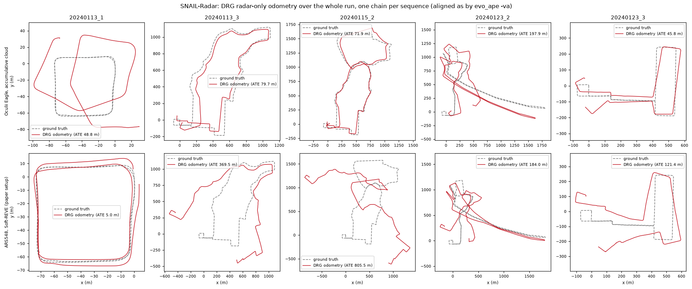

# DRG on SNAIL-Radar (not in the paper)

The paper evaluates DRG on NTU4DRadLM only. Here the same released code, **unchanged and with the paper's
parameters**, runs on five sequences of [SNAIL-Radar](https://snail-radar.github.io): 20240113_1, 20240113_3,
20240115_2, 20240123_2 and 20240123_3 (the SUV sequences). It is radar-only scan-to-scan odometry, with no IMU and
no loop closure, chained over the whole run. On the ARS548 the same odometry is also the front end of the
full 4DRadarSLAM system, run with loop closure off and on. These results were computed on 18-19 Nov 2026 and scored
on 24 Nov 2026 with [evo](https://github.com/MichaelGrupp/evo).

## Radars and inputs

| variant | radar and topic | DRG settings |
|---|---|---|
| `oculii_enhanced` | Oculii Eagle, `/radar_enhanced_pcl2`, the accumulative cloud (the topic type DRG uses on NTU4DRadLM) | paper parameters, 1 RANSAC trial ([`config/snail_radar/oculii_enhanced.yaml`](../../config/snail_radar/oculii_enhanced.yaml)) |
| `oculii_single_frame` | Oculii Eagle, `/radar_pcl2`, the single-frame cloud | paper parameters |
| `ars548_soft_reve` | Continental ARS548, `/ars548`, the whole scan; DRG's Soft-REVE weights handle moving returns, as in the paper | paper parameters, RCS floor off ([`config/snail_radar/ars548.yaml`](../../config/snail_radar/ars548.yaml)) |
| `ars548_reve_filter` | the same, but each scan first reduced to its REVE inliers (static returns) | the same |

* **Oculii accumulative cloud.** The geometry of `/radar_enhanced_pcl2` advances by one 15 Hz Eagle frame per
  published scan, whatever the time between the stamps: placed at the ground-truth poses of their stamps, two scans
  overlay best at that fixed step, not at the stamp difference. Scan matching on it therefore under-measures the
  motion, rotation included. The single-frame cloud does not have this problem, but it is too sparse for DRG's
  descriptor matching.
* **ARS548 RCS.** The ARS548 reports calibrated RCS in dBsm, mostly below 0 dB, so DRG's 0 dB RCS floor is switched
  off. Nothing else is changed.
* Normalisation statistics: every 10th scan of each sequence, as in the paper
  ([`config/norm_stats/snail_radar/`](../../config/norm_stats/snail_radar)).

## Odometry over the whole run

ATE = RMSE [m] of `evo_ape tum stamp_gt_traj.txt stamp_est_traj.txt -va` (SE(3) Umeyama alignment) over every scan
with ground truth; the best input of each sequence in bold. The trajectory chains DRG's estimates of all consecutive
scan pairs from the identity as a single chain. A pair whose registration fails contributes the identity.

| sequence | ground-truth path | `oculii_enhanced` | `oculii_single_frame` | `ars548_soft_reve` | `ars548_reve_filter` |
|---|---|---|---|---|---|
| 20240113_1 | 541 m | 48.75 | 48.98 | **5.02** | 7.39 |
| 20240113_3 | 4,609 m | **79.66** | 920.64 | 369.52 | 436.14 |
| 20240115_2 | 6,627 m | **71.90** | 892.79 | 805.51 | 598.12 |
| 20240123_2 | 8,525 m | 197.87 | 553.99 | **183.99** | 340.85 |
| 20240123_3 | 2,228 m | **45.76** | 159.08 | 121.42 | 133.89 |
| failed pairs (identity) | | 0 / 0 / 0 / 0 / 0 | 18 / 63 / 151 / 94 / 52 | 0 / 1 / 17 / 4 / 3 | 0 / 8 / 20 / 12 / 7 |

<p align="center"></p>

## DRG as the front end of 4DRadarSLAM (ARS548), without and with loop closure

The same setup as for NTU4DRadLM ([`../slam_backend/README.md`](../slam_backend/README.md)): the original launch file
with only the scan-matching odometry node replaced by DRG's odometry, loop verification on, the shipped loop gate.
Adapted to the ARS548 bags: the RCS threshold of the preprocessing (dBsm) and no radius outlier filter (it emptied
the sparse ARS548 scans). The back end also uses SNAIL's MTi-3 IMU through its preintegration edges. ATE over the
keyframes (the best of the three in bold):

| variant | sequence | keyframes | DRG odometry [m] | back end, no loop closure [m] | back end, loop closure [m] | loop closures |
|---|---|---|---|---|---|---|
| `ars548_soft_reve` | 20240113_1 | 888 | **4.49** | 6.47 | 6.47 | 0 |
| `ars548_soft_reve` | 20240113_3 | 6,984 / 6,902 | 333.01 | 385.07 | **284.05** | 0 |
| `ars548_soft_reve` | 20240115_2 | 9,429 | 770.82 | 688.36 | **688.17** | 0 |
| `ars548_soft_reve` | 20240123_2 | 11,893 | 180.98 | 176.74 | **176.64** | 0 |
| `ars548_soft_reve` | 20240123_3 | 3,381 | **107.35** | 158.14 | 158.14 | 0 |
| `ars548_reve_filter` | 20240113_1 | 887 | **6.28** | 7.53 | 7.53 | 0 |
| `ars548_reve_filter` | 20240113_3 | 6,979 | 407.56 | 387.15 | **383.46** | 0 |
| `ars548_reve_filter` | 20240115_2 | 9,425 | 564.58 | 561.26 | **561.01** | 0 |
| `ars548_reve_filter` | 20240123_2 | 11,892 | 336.07 | **329.43** | 329.47 | 0 |
| `ars548_reve_filter` | 20240123_3 | 3,379 | **126.90** | 175.43 | 175.42 | 0 |

No loop closes in any of these runs (0 loop closures in total), so the two back-end columns differ only
by the back end's run-to-run variation. Without loop closure the pose graph changes the ATE by -11 %
to +47 % relative to DRG's odometry.

## Files

| file | content |
|---|---|
| `odometry/<variant>/<seq>/stamp_est_traj.txt` | DRG odometry over the whole run (TUM), from the identity |
| `slam_backend/<variant>/<seq>/stamp_est_traj_{front_end,no_loop_closure,loop_closure}.txt` | 4DRadarSLAM keyframes: DRG odometry, after the pose graph without and with loop closure |
| `*/evo_ape*.txt`, `.zip`, `.pdf` | output of `evo_ape ... -va --save_results ... --save_plot ... --plot_mode xy`: printed statistics, saved results, plots |

**The ground truth is not included.** SNAIL-Radar is released under the
[Open Database License](https://opendatacommons.org/licenses/odbl/1-0/) (ODbL), so ground-truth poses converted
from it are not redistributed here. To score a trajectory, download the dataset's `full_trajs` and the sequence's
`tf_static.launch`, convert the ground truth to the radar frame and interpolate it at the estimate's stamps:

```bash
python3 scripts/snail_radar/snail_gt_to_radar.py --gt <full_trajs>/20240113/data1/utm50r_T_xt32.txt \
    --tf <SNAIL>/20240113/data1/tf_static.launch --sensor oculii --out gt_oculii.txt    # --sensor ars548 for the ARS548
python3 scripts/interpolate_gt.py --gt gt_oculii.txt --est stamp_est_traj.txt --out stamp_gt_traj.txt
evo_ape tum stamp_gt_traj.txt stamp_est_traj.txt -va --save_results evo_ape.zip --save_plot evo_ape.pdf --plot_mode xy
```

## Reproduce the odometry

```bash
# radar scans of one sequence -> DRG dump layout (topics: enhanced, pcl, ars548; --reve-filter for ars548_reve_filter)
python3 scripts/snail_radar/snail_to_dump.py --seq <SNAIL>/20240113/data1 --topic enhanced --out dumps/oculii_enhanced/20240113_1
# DRG on every consecutive pair (statistics and parameters of the variant)
python3 scripts/register_dump.py --dump dumps/oculii_enhanced/20240113_1 \
    --stats config/norm_stats/snail_radar/oculii_enhanced/20240113_1.yaml \
    --params config/snail_radar/oculii_enhanced.yaml --out runs/oculii_enhanced/20240113_1
```

`scripts/compute_norm_stats.py --dump ... --params config/snail_radar/ars548.yaml` recomputes the statistics with the
variant's limits. On the ARS548, SNAIL's `times.txt` lists 6 stamps twice; `snail_to_dump.py` keeps one scan per stamp.

This folder contains information from the SNAIL-Radar dataset, which is made available under the Open Database
License. Please cite it when you use these results:

```bibtex
@article{huai2025snailradar,
  author  = {Huai, Jianzhu and Wang, Binliang and Zhuang, Yuan and Chen, Yiwen and Li, Qipeng and Han, Yulong},
  title   = {SNAIL Radar: A Large-Scale Diverse Benchmark for Evaluating 4D-Radar-Based SLAM},
  journal = {The International Journal of Robotics Research},
  volume  = {44},
  number  = {12},
  pages   = {1941--1958},
  year    = {2025},
  doi     = {10.1177/02783649251329048}
}
```
